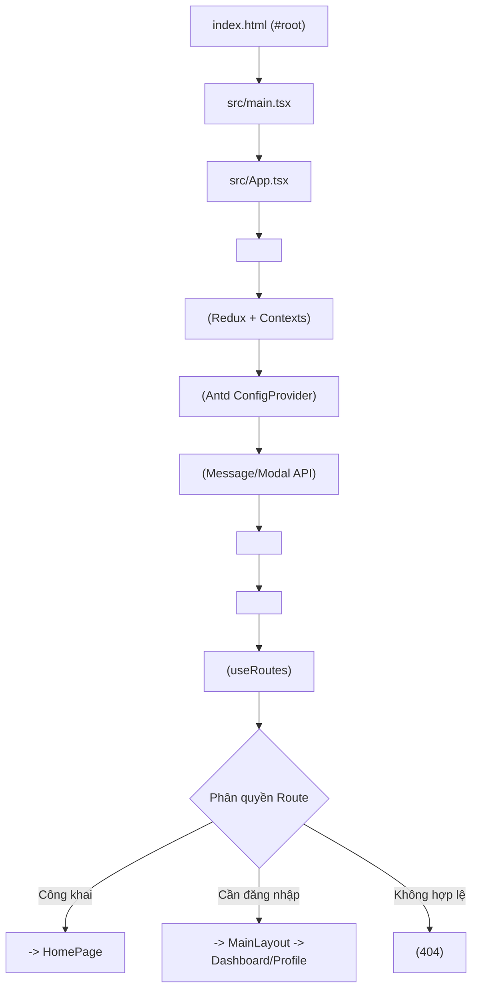
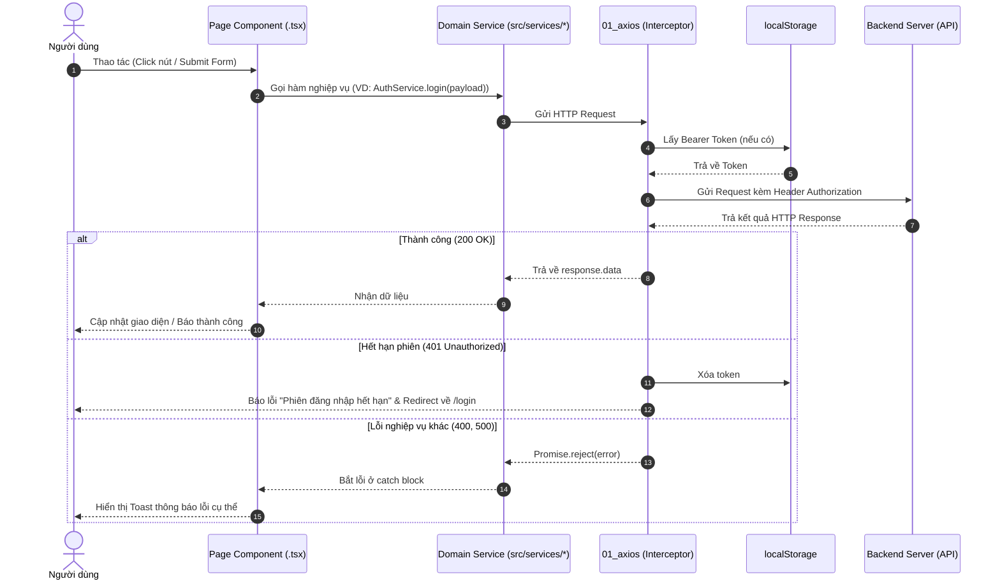

# 🏛️ Tài Liệu Toàn Diện Cấu Trúc Dự Án Frontend (VCMOS - FE)

> **Dự án:** Hệ thống Quản lý và Vận hành VCMOS  
> **Thư mục:** `SEP490_G38-VCMOS_FE`  
> **Phiên bản:** React 18 + Vite 6 + TypeScript  
> **Ngày cập nhật:** 23/10/2026

---

## 📑 Mục Lục

1. [Tổng Quan & Tech Stack](#1-tổng-quan--tech-stack)
2. [Sơ Đồ Cây Thư Mục Toàn Diện (Full Directory Tree)](#2-sơ-đồ-cây-thư-mục-toàn-diện-full-directory-tree)
3. [Chi Tiết Từng Thư Mục Cốt Lõi (`src/`)](#3-chi-tiết-từng-thư-mục-cốt-lõi-src)
   - [3.1 components/](#31-components---thành-phần-giao-diện)
   - [3.2 pages/](#32-pages---giao-diện-màn-hình)
   - [3.3 routerMap/](#33-routermap---điều-hướng--phân-trang)
   - [3.4 services/](#34-services---tầng-giao-tiếp-api)
   - [3.5 redux/ & contexts/](#35-redux--contexts---quản-lý-state)
   - [3.6 hooks/](#36-hooks---custom-react-hooks)
   - [3.7 styles/ & theme/](#37-styles--theme---hệ-thống-giao-diện)
   - [3.8 types/](#38-types---hệ-thống-kiểu-dữ-liệu-typescript)
   - [3.9 lib/ & constants/ & assets/](#39-lib-constants--assets)
4. [Kiến Trúc & Luồng Hoạt Động (Data & Application Flow)](#4-kiến-trúc--luồng-hoạt-động-data--application-flow)
5. [Quy Tắc Phát Triển Bắt Buộc (Coding Guidelines)](#5-quy-tắc-phát-triển-bắt-buộc-coding-guidelines)
6. [Môi Trường & Lệnh Thực Thi (Scripts & Environments)](#6-môi-trường--lệnh-thực-thi-scripts--environments)

---

## 1. Tổng Quan & Tech Stack

Dự án được xây dựng dựa trên kiến trúc module hóa cao, tách bạch rõ ràng giữa tầng hiển thị giao diện (UI), tầng nghiệp vụ / gọi API (Services), và tầng dữ liệu toàn cục (Redux / Contexts).

### Công Nghệ Chủ Đạo

| Phân loại            | Thư viện / Công nghệ                          | Mục đích                                                          |
| :------------------- | :-------------------------------------------- | :---------------------------------------------------------------- |
| **Core**             | `React 18` + `Vite 6` + `TypeScript 5.4`      | Nền tảng SPA hiệu năng cao, type-safe                             |
| **UI Library**       | `Ant Design (antd 5.x)`                       | Thư viện UI component chuẩn doanh nghiệp                          |
| **Styling**          | `styled-components` + `Sass (SCSS)`           | Custom style cục bộ và hệ thống design tokens SCSS 7-1            |
| **State Management** | `Redux Toolkit` + `React Context`             | Quản lý global app state và UI state chuyên biệt                  |
| **Routing**          | `React Router v7 / v6`                        | Quản lý định tuyến SPA, Lazy Loading, Route Guards                |
| **HTTP Client**      | `Axios 1.8`                                   | Xử lý request, tự động đính Bearer token, interceptor bắt lỗi 401 |
| **Notification**     | `sonner`                                      | Hệ thống thông báo toast hiện đại, mượt mà                        |
| **Auth & Social**    | `@react-oauth/google`                         | Tích hợp xác thực đăng nhập Google                                |
| **Code Quality**     | `ESLint 9`, `Prettier`, `Husky`, `Commitlint` | Kiểm soát chuẩn cú pháp, tự động format và chuẩn hóa commit       |

---

## 2. Sơ Đồ Cây Thư Mục Toàn Diện (Full Directory Tree)

```text
SEP490_G38-VCMOS_FE/
├── .husky/                               # Git hooks (pre-commit, commit-msg kiểm tra commitlint)
├── .github/                              # CI/CD workflows và GitHub config
├── public/                               # Tệp tĩnh công khai không qua bundling
├── src/                                  # Mã nguồn chính của ứng dụng
│   ├── assets/                           # Tài nguyên tĩnh nội bộ
│   │   ├── fonts/                        # Phông chữ tùy chỉnh (Inter, Open Sans...)
│   │   ├── images/                       # Ảnh minh họa, banner, icon tĩnh
│   │   │   ├── common-icon/              # Ảnh biểu tượng dùng chung (Login, Error, Forget...)
│   │   │   └── logo/                     # Logo thương hiệu VCMOS
│   │   └── react.svg
│   │
│   ├── components/                       # Các component tái sử dụng trong hệ thống
│   │   ├── common/                       # Component tiện ích độc lập nghiệp vụ
│   │   │   ├── Boundary/                 # Error Boundary bao bọc bắt lỗi runtime UI
│   │   │   ├── FloatAction/              # Nút hành động nổi (back-to-top, quick action)
│   │   │   ├── LayoutAdminCommon/        # Khung layout dùng cho trang quản trị
│   │   │   ├── LayoutCommon/             # Khung layout trang chung
│   │   │   ├── LinkCusstom/              # Thẻ link điều hướng bọc sẵn
│   │   │   ├── Spin/                     # Hiệu ứng loading toàn trang hoặc cục bộ
│   │   │   ├── SvgIcon/                  # Bộ sưu tập các icon SVG tùy biến
│   │   │   └── GoogleLoginModal.tsx      # Modal xác thực đăng nhập Google
│   │   ├── layout/                       # Thành phần cấu trúc khung nhìn chính
│   │   │   ├── Breadcrumb/               # Thanh điều hướng phân cấp đường dẫn
│   │   │   ├── DefaultAction/            # Các hành động mặc định gắn liền layout
│   │   │   ├── Header/                   # Header chung của hệ thống (User menu, chuông thông báo)
│   │   │   ├── HomeLayout/               # Layout dành cho trang chủ (HomeHeader, HomeFooter)
│   │   │   └── MainLayout/               # Layout chính cho trang quản trị/nội bộ (Sidebar, Header, Main content)
│   │   └── Providers/                    # Nơi bọc toàn bộ context và redux store
│   │
│   ├── constants/                        # Chứa các hằng số cố định trong toàn dự án
│   │   ├── constants.ts                  # Cấu hình chung, key hệ thống
│   │   ├── pageSizeOptions.ts            # Tùy chọn phân trang (10, 20, 50 bản ghi)
│   │   └── Token.ts                      # Tên key token trong Storage
│   │
│   ├── contexts/                         # React Contexts cho các state nhẹ/cục bộ
│   │   ├── routerProvider/               # Các context hỗ trợ router và UI layout
│   │   │   ├── authContext.tsx           # Context lưu trạng thái đăng nhập
│   │   │   ├── collapseMenuContext.tsx   # Context đóng/mở thanh Sidebar
│   │   │   ├── isLoginContext.tsx        # Cờ xác định trạng thái login
│   │   │   ├── routerContext.tsx         # Thông tin router hiện hành
│   │   │   └── themeContext.tsx          # Context Dark/Light mode
│   │   └── index.tsx                     # Hợp nhất các Context Provider
│   │
│   ├── hooks/                            # Custom React Hooks
│   │   ├── Common/
│   │   │   ├── debouncer/                # useDebounce - tối ưu tìm kiếm real-time
│   │   │   ├── useAuth/                  # Hook lấy thông tin xác thực người dùng
│   │   │   ├── useFetch/                 # Hook hỗ trợ gọi dữ liệu bất đồng bộ
│   │   │   ├── useMobile/                # Hook nhận diện thiết bị mobile / tablet
│   │   │   ├── useModal/                 # Hook quản lý trạng thái mở/đóng modal
│   │   │   ├── useTable/                 # Hook quản lý phân trang, lọc của Antd Table
│   │   │   └── useUpload/                # Hook xử lý tải lên file/ảnh
│   │   └── index.ts                      # Export tập trung các hooks
│   │
│   ├── lib/                              # Thư viện tiện ích (Utility Libraries)
│   │   ├── storage/                      # Trình bao bọc an toàn cho localStorage/sessionStorage
│   │   ├── dateUtils.ts                  # Tiện ích định dạng ngày giờ (Dayjs / Moment)
│   │   ├── seo.ts                        # Tiện ích thiết lập meta SEO tiêu đề trang
│   │   ├── stringsUtils.ts               # Xử lý chuỗi, cắt ngắn, format tiền tệ
│   │   ├── useWindowSize.ts              # Theo dõi kích thước màn hình
│   │   └── utils.ts                      # Hàm trợ giúp tổng hợp
│   │
│   ├── pages/                            # CÁC MÀN HÌNH CHÍNH (Giao diện người dùng)
│   │   ├── ANONYMOUS/                    # Các màn hình chưa đăng nhập
│   │   │   └── Login_Register/           # Đăng nhập, đăng ký, quên mật khẩu, kích hoạt tài khoản
│   │   ├── Dashboard/                    # Màn hình bảng điều khiển tổng quan
│   │   ├── Home/                         # Trang chủ giới thiệu hệ thống
│   │   ├── Profile/                      # Màn hình thông tin cá nhân người dùng
│   │   └── SUPPORTPAGES/                 # Các trang tiện ích & điều hướng hỗ trợ
│   │       ├── NotFound/                 # Trang lỗi 404
│   │       ├── ProtectedRoute/           # HOC bảo vệ các route yêu cầu đăng nhập
│   │       └── PublicRouters/            # Bao bọc các route công khai (không cần login)
│   │
│   ├── redux/                            # Quản lý State toàn cục bằng Redux Toolkit
│   │   ├── reducers/                     # Nơi tổng hợp các reducer con
│   │   ├── slices/                       # Các lát cắt dữ liệu (VD: appGlobal.slice.ts)
│   │   ├── hooks.ts                      # Typed hooks: useAppDispatch, useAppSelector
│   │   └── store.ts                      # Cấu hình Redux Store
│   │
│   ├── routerMap/                        # Bản đồ định tuyến (Routing Configuration)
│   │   ├── AppRouter.tsx                 # Khởi tạo React Router (useRoutes + Suspense Lazy Load)
│   │   ├── ROUTER.ts                     # Danh sách các hằng số URL (VD: ROUTER.DASHBOARD)
│   │   ├── MenuItem.tsx                  # Khai báo danh sách menu sidebar/header theo phân quyền
│   │   └── breadcrumbMap.ts              # Ánh xạ URL sang tên hiển thị trên thanh Breadcrumb
│   │
│   ├── services/                         # TẦNG GỌI API (Domain-Driven API Services)
│   │   ├── 01_axios/                     # Cấu hình Axios instance & Interceptors (Token, 401 redirect)
│   │   ├── AuthService/                  # Gọi API liên quan đến Xác thực (Login, Register, OTP...)
│   │   │   ├── urls.ts                   # Định nghĩa chuỗi URL API
│   │   │   └── index.ts                  # Các hàm axios tương ứng
│   │   └── UserService/                  # Gọi API tài khoản người dùng, đổi thông tin
│   │       ├── urls.ts
│   │       └── index.ts
│   │
│   ├── styles/                           # Hệ thống Stylesheets (SCSS Kiến trúc 7-1)
│   │   ├── abstracts/                    # Biến, hàm, mixin (không sinh ra CSS thuần)
│   │   │   ├── colors/                   # Bảng màu hệ thống, theme màu chữ, nền
│   │   │   ├── functions/                # Hàm tính toán SCSS
│   │   │   ├── mixins/                   # Responsive breakpoints, theme mixins
│   │   │   ├── typography/               # Font family, font size, line height
│   │   │   └── variables/                # Biến layout, kích thước chung
│   │   ├── base/                         # Thiết lập cơ sở: Reset CSS, Typography, Scrollbar
│   │   ├── layout/                       # Grid hệ thống, spacing, breakpoints
│   │   ├── vendors/                      # Tùy biến CSS thư viện bên ngoài (Antd, Sonner Toaster)
│   │   ├── globals.css                   # Định nghĩa biến CSS variables toàn cục
│   │   └── _index.scss                   # Điểm nạp tập trung toàn bộ SCSS
│   │
│   ├── theme/                            # Cấu hình chủ đề Ant Design
│   │   ├── GlobalThemeConfig.tsx         # Bọc Provider Antd ConfigProvider
│   │   └── ThemeConfigAntd.tsx           # Tùy biến theme tokens (Màu chính, border radius, font)
│   │
│   ├── types/                            # Khai báo kiểu TypeScript (Type Definitions)
│   │   ├── api/                          # Định dạng Request, Response, ApiResult, Role API, User API
│   │   ├── enums/                        # Các enum (Trạng thái đơn hàng, trạng thái tài khoản...)
│   │   ├── models/                       # Type thực thể dữ liệu (User, Role, Product...)
│   │   ├── utils/                        # Type tiện ích
│   │   ├── env.d.ts                      # Khai báo kiểu cho biến môi trường Vite (import.meta.env)
│   │   ├── global.d.ts                   # Định nghĩa biến toàn cục
│   │   └── index.ts                      # Export tập trung các types
│   │
│   ├── App.tsx                           # Root Component (Tích hợp Providers, Theme, Router, Toast)
│   ├── main.tsx                          # Entry point khởi chạy ứng dụng React DOM
│   └── vite-env.d.ts                     # Typescript declarations cho Vite
│
├── .env                                  # Biến môi trường mặc định
├── .env.development                      # Biến môi trường chế độ development
├── .env.example                          # File mẫu cấu hình biến môi trường
├── .gitignore                            # Các tệp bỏ qua khi commit git
├── .lintstagedrc.json                    # Cấu hình lint-staged khi commit
├── .prettierrc / .prettierignore         # Cấu hình định dạng mã nguồn Prettier
├── commitlint.config.cjs                 # Cấu hình chuẩn commit message Conventional Commits
├── eslint.config.js                      # Cấu hình kiểm tra lỗi mã nguồn ESLint v9
├── index.html                            # Tệp HTML gốc nạp thẻ #root
├── package.json                          # Khai báo thư viện và scripts dự án
├── tsconfig.json                         # Cấu hình TypeScript gốc
├── tsconfig.app.json                     # Cấu hình TypeScript cho mã nguồn app
├── tsconfig.node.json                    # Cấu hình TypeScript cho môi trường node/vite
└── vite.config.ts                        # Cấu hình trình đóng gói Vite (alias `@/`, plugins, port)
```

---

## 3. Chi Tiết Từng Thư Mục Cốt Lõi (`src/`)

### 3.1 `components/` - Thành Phần Giao Diện

- **`components/Providers/index.tsx`**: Bọc Redux Provider và React Contexts Provider lại với nhau để cung cấp trạng thái xuống cây component.
- **`components/layout/`**:
  - `MainLayout`: Sử dụng cho giao diện phân quyền nội bộ (Dashboard, Quản lý). Đã tích hợp sẵn Sidebar thu/phóng linh hoạt, Header có Avatar người dùng và chuông thông báo, Breadcrumb tự sinh theo URL.
  - `HomeLayout`: Dành cho trang giới thiệu chung, landing page ngoài cùng (Header + Nội dung + Footer).
- **`components/common/`**:
  - `Boundary`: Bắt lỗi JavaScript bất ngờ ở cây component để tránh làm sập trắng màn hình (`ErrorBoundary`).
  - `Spin`: Hiệu ứng loading quay tròn chuẩn Antd, hỗ trợ toàn trang.

---

### 3.2 `pages/` - Giao Diện Màn Hình

Tổ chức màn hình theo từng phân hệ chức năng:

- **`pages/ANONYMOUS/`**: Các trang dành cho người dùng chưa đăng nhập.
  - Bao gồm thư mục `Login_Register/components/` với đầy đủ các form: `LoginForm.tsx`, `RegisterForm.tsx`, `ForgotPasswordForm.tsx`, `VerifyAccountForm.tsx`, `CompleteProfileForm.tsx`.
- **`pages/Home/`**: Trang chủ giới thiệu.
- **`pages/Dashboard/`**: Trang tổng quan số liệu phân tích sau khi đăng nhập.
- **`pages/Profile/`**: Trang xem và cập nhật hồ sơ cá nhân.
- **`pages/SUPPORTPAGES/`**:
  - `ProtectedRoute`: Kiểm tra xem người dùng đã đăng nhập chưa; nếu chưa, tự động điều hướng về `/login`.
  - `PublicRouters`: Layout bọc các trang công khai.
  - `NotFound`: Trang 404 khi người dùng truy cập vào URL không tồn tại.

---

### 3.3 `routerMap/` - Điều Hướng & Phân Trang

- **`ROUTER.ts`**: Nơi duy nhất khai báo chuỗi đường dẫn (URL Path), tránh việc hardcode URL rải rác:
  ```typescript
  const ROUTER = {
    DEFAULT: '/',
    HOME: '/',
    LOGIN: '/login',
    REGISTER: '/register',
    DASHBOARD: '/dashboard',
    PROFILE: '/profile',
    NOT_FOUND: '*',
  };
  export default ROUTER;
  ```
- **`AppRouter.tsx`**: Khai báo danh sách các Route sử dụng hàm `useRoutes` của React Router và bọc các trang trong `React.lazy` + `<Suspense>` để tối ưu tải trang (Lazy Loading).
- **`MenuItem.tsx`**: Khai báo cấu trúc danh mục cho Sidebar, tích hợp kiểm tra quyền (Role-based Menu).
- **`breadcrumbMap.ts`**: Ánh xạ URL sang tiêu đề tiếng Việt hiển thị trên thanh Breadcrumb.

---

### 3.4 `services/` - Tầng Giao Tiếp API

Kiến trúc tuân theo chuẩn **Domain-Driven Services** (Tách rời đường dẫn và logic xử lý):

1. **`01_axios/index.ts`**:
   - Khởi tạo Axios instance với `baseURL: import.meta.env.VITE_API_ROOT`.
   - **Request Interceptor:** Tự động lấy Token từ `storage.getLocalStorage(STORAGE.TOKEN)` và gán vào header `Authorization: Bearer <token>`.
   - **Response Interceptor:** Kiểm tra mã lỗi backend trả về; nếu gặp mã `401`, hệ thống hiển thị thông báo phiên hết hạn, xóa token và tự động redirect về trang login.
2. **Cấu trúc mỗi Service con (VD: `AuthService/`, `UserService/`):**
   - File `urls.ts`: Chỉ chứa khai báo API endpoint URL.
   - File `index.ts`: Import `instance` từ `01_axios` và xuất ra đối tượng chứa các hàm gọi API tương ứng.

---

### 3.5 `redux/` & `contexts/` - Quản Lý State

- **Redux Toolkit (`src/redux/`)**:
  - `store.ts`: Khởi tạo Redux Store trung tâm.
  - `slices/appGlobal.slide.ts`: Quản lý các trạng thái toàn cục lớn như thông tin tài khoản đăng nhập hiện tại (`currentUser`), danh sách quyền, cấu hình hệ thống.
  - `hooks.ts`: Định nghĩa typed hooks `useAppDispatch` và `useAppSelector` chuẩn TypeScript.
- **React Contexts (`src/contexts/routerProvider/`)**:
  - Quản lý các trạng thái cục bộ của UI: `themeContext` (Dark/Light), `collapseMenuContext` (Đóng/mở Sidebar), `authContext` (Trạng thái đăng nhập nhanh).

---

### 3.6 `hooks/` - Custom React Hooks

Bộ sưu tập các hook dùng chung giúp tái sử dụng logic xử lý:

- `useDebounce`: Trì hoãn việc gọi API khi người dùng gõ tìm kiếm liên tục.
- `useMobile`: Nhận biết màn hình hiện tại có phải mobile / tablet hay không để render giao diện phù hợp.
- `useTable`: Đồng bộ hóa trạng thái sắp xếp, lọc, số trang cho bảng Ant Design Table.
- `useModal`: Điều khiển trạng thái đóng / mở / truyền dữ liệu vào Modal dễ dàng.

---

### 3.7 `styles/` & `theme/` - Hệ Thống Giao Diện

- **Kiến trúc SCSS 7-1**:
  - `abstracts/`: Định nghĩa các biến scss (`$color-primary`, `$font-size-base`), mixin responsive cho mobile/desktop.
  - `base/`: Khởi tạo lại CSS mặc định (`_reset.scss`), tùy biến thanh cuộn (`_scrollbar.scss`).
  - `vendors/`: Tinh chỉnh đè style mặc định của Ant Design (`_custom-antd.scss`) và Sonner Toast (`_toaster.scss`).
- **`theme/ThemeConfigAntd.tsx`**:
  - Cấu hình bảng màu chuẩn doanh nghiệp cho Ant Design qua component `<ConfigProvider theme={...} />`.

---

### 3.8 `types/` - Hệ Thống Kiểu Dữ Liệu TypeScript

Tất cả type đều được phân loại rõ ràng:

- `types/api/response.api.ts`: Kiểu phản hồi chuẩn từ server backend (`ApiResponse<T>`, phân trang `PaginationResponse<T>`).
- `types/models/`: Định nghĩa thực thể nghiệp vụ (`IUser`, `IRole`).
- `types/env.d.ts`: Định nghĩa các biến môi trường Vite (`VITE_API_ROOT`, `VITE_GOOGLE_CLIENT_ID`).

---

## 4. Kiến Trúc & Luồng Hoạt Động (Data & Application Flow)

### 4.1 Luồng Khởi Chạy Ứng Dụng (Application Bootstrapping)



---

### 4.2 Luồng Gọi API & Dữ Liệu (API & Data Flow)



---

## 5. Quy Tắc Phát Triển Bắt Buộc (Coding Guidelines)

Mọi thành viên trong nhóm và trợ lý AI khi làm việc trên dự án này **phải tuân thủ 4 nguyên tắc sau**:

### 1. Dùng Trực Tiếp Ant Design Component (Không Bọc Vỏ Thừa)

- **Đúng**: `import { Button, Input, Table, Modal } from 'antd';` và sử dụng trực tiếp `<Button type="primary">`.
- **Sai**: Tự tạo `CustomButton`, `InputWrapper` làm phức tạp hóa mã nguồn.

### 2. Tùy Biến Style Bằng `styled-components`

- Khi cần chỉnh lại màu sắc hoặc padding của component Antd ngoài chuẩn mặc định, sử dụng `styled-components` ngay trong file đó:

  ```tsx
  import styled from 'styled-components';
  import { Button } from 'antd';

  export const CustomActionButton = styled(Button)`
    border-radius: 8px;
    font-weight: 600;
  `;
  ```

### 3. Tuyệt Đối Không Gọi `axios` Trực Tiếp Trong Component UI

- Tất cả các lệnh gọi API phải thông qua thư mục `src/services/`.
- Mỗi module nghiệp vụ mới phải có:
  1. Thư mục `src/services/<TênModule>Service/`
  2. File `urls.ts` khai báo endpoint.
  3. File `index.ts` khai báo các hàm gọi API sử dụng `01_axios`.

### 4. Cấu Trúc Thư Mục Một Trang (Page Structure Rule)

- Thư mục gốc của mỗi Page (VD: `src/pages/Dashboard/`) **chỉ được chứa duy nhất file `index.tsx`**.
- Mọi component con chia nhỏ, dialog form, hoặc file SCSS đi kèm **bắt buộc phải nằm trong thư mục `components/`** bên trong page đó:
  ```text
  src/pages/Dashboard/
  ├── components/
  │   ├── ChartSummary.tsx
  │   ├── TableUserRecent.tsx
  │   └── dashboard.module.scss
  └── index.tsx                    <-- Điểm vào duy nhất của Page
  ```

### 5. Quy Tắc Commit Git (Conventional Commits)

Dự án đã tích hợp Husky và Commitlint. Mọi commit message phải có tiền tố hợp lệ:

- `feat: <nội dung>`: Thêm tính năng mới (VD: `feat: tích hợp trang quản lý đơn hàng`)
- `fix: <nội dung>`: Sửa lỗi (VD: `fix: sửa lỗi mất token khi refresh trang`)
- `chore: <nội dung>`: Cập nhật thư viện, cấu hình build
- `refactor: <nội dung>`: Tối ưu hoặc cấu trúc lại mã nguồn mà không đổi logic
- `style: <nội dung>`: Chỉnh sửa CSS, định dạng giao diện

> ⚠️ **Lưu ý:** Nhánh `main` trên GitHub là Protected Branch. Không được push trực tiếp lên `main`, mà phải tạo nhánh tính năng (VD: `feature/ten-chuc-nang`) và mở **Pull Request (PR)**.

---

## 6. Môi Trường & Lệnh Thực Thi (Scripts & Environments)

### Biến Môi Trường (`.env`)

| Tên biến                | Mô tả                               | Ví dụ                             |
| :---------------------- | :---------------------------------- | :-------------------------------- |
| `VITE_API_ROOT`         | URL gốc của máy chủ backend API     | `http://localhost:8080/api/v1`    |
| `VITE_GOOGLE_CLIENT_ID` | Client ID cho xác thực Google OAuth | `xxxx.apps.googleusercontent.com` |

### Các Lệnh Thực Thi (NPM Scripts)

```bash
# Cài đặt thư viện phụ thuộc
npm install

# Chạy môi trường phát triển (Development) tại http://localhost:5173
npm run dev

# Kiểm tra kiểu TypeScript không sinh file
npm run typecheck

# Quét và tự động sửa lỗi định dạng / cú pháp mã nguồn
npm run lint

# Đóng gói ứng dụng để đưa lên môi trường Production (Build ra thư mục dist/)
npm run build

# Chạy thử bản build sau đóng gói
npm run preview
```
